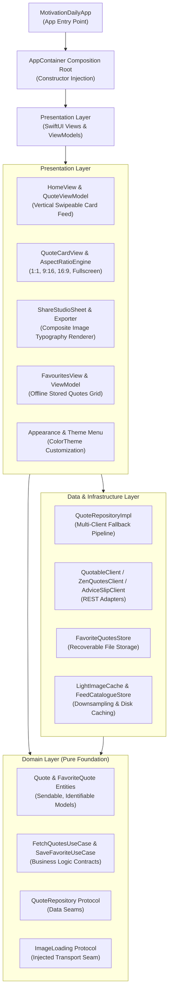
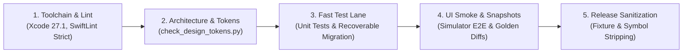
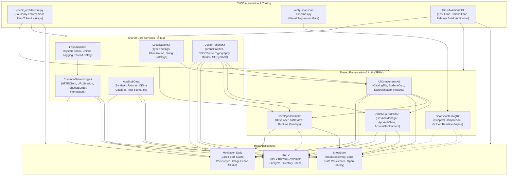

# Motivation Daily 🌟

A modern, fluid iOS application delivering daily inspirational quotes paired with curated, high-resolution aesthetic wallpapers. Built with SwiftUI and Swift Concurrency following Clean Architecture and strict dependency injection.


Built by [Anurag Chourasia](https://github.com/Anurag-Chourasia), iOS Engineer. Motivation Daily delivers daily curated wisdom across diverse categories (Inspiration, Life, Happiness, Success, Wisdom) with dynamic session randomization, non-destructive aspect ratio adaptations, composite wallpaper studio sharing, and recoverable offline favorites persistence.

---

## 1. Executive Summary & Product Vision

Motivation Daily demonstrates how to build responsive, rich-media client applications with rock-solid architectural foundations:
- **Decoupled View Coordination (IOS-80, IOS-81)**: Feed caching, photo export rendering, and network image loading services (`any ImageLoading`) are explicitly injected throughout the view hierarchy rather than tightly coupled inside monolithic views.
- **Recoverable Offline Favorites (IOS-78)**: Implements non-destructive file migration for saved quote collections, preserving legacy records and fallback backups in the event of filesystem or permission disruptions.
- **Pure Domain Localization (IOS-79)**: Domain models and entities are strictly stripped of UI and localization dependencies; quote source labeling is localized within the presentation layer via `MotivationStrings`.
- **Architectural Boundary Enforcement (IOS-83)**: 100% compliant with workspace design token rules—zero hardcoded color literals, tokenized iconography, and zero visual framework leaks in domain layers.

---

## 2. Architecture & Design Principles

The application adheres to **Clean Architecture + MVVM** with a unified application container (`AppContainer`):



### Layer Breakdown:
1. **Presentation Layer (`MotivationDaily/Presentation/`)**:
   - `HomeView` & `QuoteViewModel`: Unidirectional state handling vertical paging, session randomization, and category switching.
   - `QuoteCardView`: Custom card layout engine supporting on-the-fly aspect ratio transitions (`Fullscreen`, `1:1`, `16:9`, `9:16`) without altering image canvas quality.
   - `ShareStudioSheet`: Offscreen graphics context rendering composite high-resolution cards with dynamic typography for Photos/Files export.
2. **Domain Layer (`MotivationDaily/Domain/`)**:
   - `Domain/Entities/Quote.swift`: Pure Swift entity independent of UI frameworks.
   - `Domain/UseCases/`: Protocol-driven use cases for quote retrieval and bookmark management.
   - Pure Foundation models ensuring fast, isolated unit test execution.
3. **Data Layer (`MotivationDaily/Data/`)**:
   - `QuoteRepositoryImpl`: Fallback coordination across multiple public quote providers (`Quotable`, `ZenQuotes`, `AdviceSlip`).
   - `FavoriteQuotesStore`: Robust JSON file storage with atomic writes, legacy data schema migration, and backup directory recovery.
   - `LightImageCache`: Actor-isolated memory cache performing asynchronous image downsampling and display preparation (`preparingForDisplay()`).
4. **Composition Root (`MotivationDaily/App/AppContainer.swift`)**:
   - Wires concrete clients into repositories and injects use cases, image services, and stores into top-level views.

---

## 3. Shared SPM Package Integration

Motivation Daily integrates 8 shared Swift Packages:

| Package | Integration Role | Host Ingestion Seam |
|---|---|---|
| **DesignTokensKit** (`v1.22.3`) | Brand palette (`BrandPalette.motivationDaily`), spacing, typography, and SF Symbols. | `MotivationDaily/Presentation/` |
| **UIComponentsKit** (`v1.9.0`) | Reusable surfaces, `StateMessage` error views, `TokenButtonStyle`, and layout recipes. | `MotivationDaily/Presentation/Views/Components/` |
| **AuthKit & AuthKitUI** (`v0.8.0`) | Account session state, authentication gate, and navigation `AccountToolbarItem`. | `MotivationDaily/App/MotivationDailyApp.swift` |
| **FoundationKit** (`v0.2.0`) | Clock abstractions for quote rotation and unified logging. | `MotivationDaily/Core/` |
| **LocalisationKit** (`v0.8.1`) | Localized quote category labels, share studio actions, and error messages. | Throughout all presentation views |
| **CommonNetworkingKit** (`v2.0.0`) | Deterministic HTTP transport engine and redacting request logger. | `MotivationDaily/Data/Network/` |
| **DeveloperProfileKit** (`v1.2.0`) | "Know Your Developer" attribution and professional links. | Accessible via settings sheet |
| **AppStubData** (`v1.0.0`) | Synthetic quote feeds and offline UI test seed data (`motivationdaily-ui-fixtures.json`). | `MotivationDaily/Developer/` |
| **SnapshotTestingKit** (`v1.0.3`) | Golden-image visual regression assertions on quote card variations. | `MotivationDailySnapshotTests/` |

---

## 4. Scripts, Tooling & Automation Catalog

All developer scripts and test runners are organized under `Scripts/`:

| Script | Purpose & Rationale | Local Execution Command |
|---|---|---|
| `Scripts/bootstrap.sh` | Resolves pinned private dependencies, checks submodules, and builds Debug simulator binary. | `bash Scripts/bootstrap.sh` |
| `Scripts/check_design_tokens.py` | Scans codebase ensuring 0 design token violations and complete BrandPalette adoption. | `python3 Scripts/check_design_tokens.py` |
| `Scripts/check_coverage.py` | Validates minimum line and branch test coverage across Domain and Data layers. | `python3 Scripts/check_coverage.py` |
| `Scripts/verify-release-fixtures.py` | Verifies that mock JSON catalogs and UI test seeds are stripped from Release builds. | `python3 Scripts/verify-release-fixtures.py` |
| `Scripts/test-fast.sh` | Executes Fast test lane (unit tests, store migration, use case logic). | `bash Scripts/test-fast.sh` |
| `Scripts/test-smoke.sh` | Runs UI Smoke test lane for critical user journeys (Swipe -> Aspect Ratio -> Share -> Favorite). | `bash Scripts/test-smoke.sh` |
| `Scripts/test-snapshots.sh` | Executes pixel-level visual regression tests against pinned iPhone 11 simulator. | `bash Scripts/test-snapshots.sh` |
| `Scripts/test-integration.sh` | Tests live and stubbed network clients and image caching pipelines. | `bash Scripts/test-integration.sh` |
| `Scripts/verify-snapshot-baselines.py` | Validates reference snapshot images and blocks recording overrides in CI. | `python3 Scripts/verify-snapshot-baselines.py` |
| `Scripts/verify-snapshot-boundary.py` | Guarantees snapshot test symbols are never compiled into Release targets. | `bash Scripts/verify-snapshot-boundary.py` |

---

## 5. Continuous Integration & Quality Gates

The GitHub Actions CI pipeline (`.github/workflows/ci.yml`) enforces multi-tiered verification on every PR and push:



---

## 6. Local Setup & Contribution Guide

### Prerequisites:
- macOS Sonoma or Sequoia with **Xcode 27.1** installed (`/Applications/Xcode 27.1.app`).
- Python 3.10+ installed and on `PATH`.
- Pinned iPhone 11 Simulator installed.

### Step-by-Step Setup:
```sh
# 1. Clone repository
git clone https://github.com/Anurag-Chourasia/MotivationDaily.git
cd "Motivation Daily"

# 2. Bootstrap dependencies and build Debug simulator binary
DEVELOPER_DIR='/Applications/Xcode 27.1.app/Contents/Developer' bash Scripts/bootstrap.sh

# 3. Run fast unit test suite
DEVELOPER_DIR='/Applications/Xcode 27.1.app/Contents/Developer' bash Scripts/test-fast.sh

# 4. Run UI Smoke tests
DEVELOPER_DIR='/Applications/Xcode 27.1.app/Contents/Developer' bash Scripts/test-smoke.sh
```

---

## 7. End-to-End Ecosystem Connectivity



---

## 8. Canonical Notion Dashboards & Governance Links

- [iOS Portfolio — Engineering Tickets Dashboard](https://app.notion.com/p/c20d7f4b133b44499c8ac0b4d5f6249e?pvs=204)
- [iOS Portfolio — Master Document](https://app.notion.com/p/40ffa5f855b98192ad2ede66a5d36fe7)
- [Architecture Boundary Validator (`check_architecture.py`)](file:///Users/anuragchourasia/Desktop/Projects/UIComponentsKit/Scripts/check_architecture.py)
- [Release & Gate Policy Documentation (`Docs/MASTER.md`)](file:///Users/anuragchourasia/Desktop/Projects/Docs/MASTER.md)
