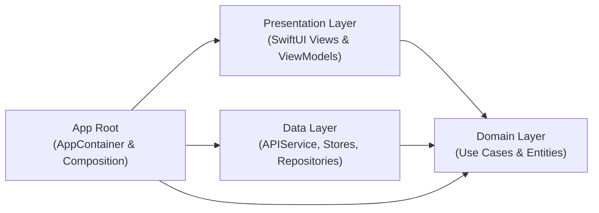

# Motivation Daily 🌟

A modern, fluid iOS application delivering daily inspirational quotes paired with curated, high-resolution aesthetic wallpapers. Built with SwiftUI and Swift Concurrency following Clean Architecture and MVVM principles.

---

## 📱 Features

- **Infinite Motivational Feed**: Vertical swipeable card feed with smooth transitions and real-time pre-warming.
- **Dynamic Session Randomization**: Starts on a randomized quote and wallpaper every time the app opens, preventing repetitive order while maintaining scroll stability within the session.
- **Curated Category Sections**: Switch seamlessly between categories including **Happiness**, **Inspiration**, **Life**, **Success**, **Wisdom**, and **Random**.
- **Non-Destructive Aspect Ratio Customization**: Switch wallpaper display ratios between **Fullscreen**, **1:1**, **16:9**, and **9:16** without degrading or losing the original image canvas.
- **Bookmarks & Favorites**: Save favourite quotes and wallpapers locally for offline browsing and reflection.
- **Rich Share Studio**:
  - Export beautiful composite wallpaper images with embedded typography.
  - Share wallpaper image only.
  - Share quote text only.
  - Copy quote and author directly to clipboard.
  - Save directly to Photos library.
- **Accent Theme Personalization**: Customize UI accent colors across the app.

---

## 🏗 Architecture & Tech Stack

The project adheres to **Clean Architecture + MVVM** with strict layer separation:



### Layer Breakdown
- **App (`MotivationDaily/App/`)**: Dependency injection root (`AppContainer`) wiring use cases, network services, and view models.
- **Domain (`MotivationDaily/Domain/`)**: Pure business logic containing entity models (`Quote`, `FavoriteQuote`), repository protocols, use cases, and domain error definitions. Independent of UI and external SDKs.
- **Data (`MotivationDaily/Data/`)**: Concrete implementations of repositories, network clients (`QuotableClient`, `ZenQuotesClient`, `AdviceSlipClient`), in-memory/disk caching (`FeedCatalogueStore`, `LightImageCache`), and JSON persistence.
- **Presentation (`MotivationDaily/Presentation/`)**: SwiftUI views, view models (`QuoteViewModel`, `FeedPageViewModel`), layout engines (`QuoteCardLayout`), and gesture interaction handlers.

### Technologies
- **UI Framework**: SwiftUI
- **Concurrency**: Swift Concurrency (`async`/`await`, `Task`, `actor`)
- **Minimum Target**: iOS 15.0+
- **Image Pipeline**: Custom `LightImageCache` with async image downsampling and display preparation (`preparingForDisplay()`).

---

## 📂 Project Structure

```text
Motivation Daily/
├── MotivationDaily.xcodeproj
├── MotivationDaily/
│   ├── App/
│   │   ├── MotivationDailyApp.swift
│   │   └── AppContainer.swift
│   ├── Domain/
│   │   ├── Entities/
│   │   ├── Repositories/
│   │   ├── UseCases/
│   │   └── Errors/
│   ├── Data/
│   │   ├── Catalog/
│   │   ├── Network/
│   │   └── Repositories/
│   ├── Presentation/
│   │   ├── ViewModels/
│   │   ├── Views/
│   │   │   ├── Components/
│   │   │   ├── Favourites/
│   │   │   └── HomeView.swift
│   │   └── Shared/
│   └── Assets.xcassets
└── MotivationDailyUITests/
    ├── HomeFlowTests.swift
    └── UITestBase.swift
```

---

## 📋 Known Issues & Tracking

The following items are actively tracked for the Favorites / Bookmarks feature:

### 1. Custom Ratio Favorite Image Retention
- **Description**: Saving a quote when set to a custom aspect ratio (e.g. `1:1`) writes the cropped image data to disk. When reviewing the saved quote in Bookmarks/Favorites, resizing back to Fullscreen or other ratios cannot restore the original uncropped image canvas.
- **Planned Solution**: Persist the uncropped original master image (`content.originalImage`) alongside the chosen aspect ratio metadata, allowing non-destructive re-cropping on demand in the favorites full-screen viewer.

### 2. Sandbox Container Image Persistence Across Reopens
- **Description**: Saved favorite images can become unavailable after the app is reopened multiple times.
- **Root Cause**: `DefaultFavoritesRepository` currently stores absolute file paths (`fileURL.path`) in `UserDefaults`. In iOS, the sandbox container UUID changes between app launches and updates, causing absolute paths to become invalid.
- **Planned Solution**: Store only relative file names in `FavoriteQuote.localImagePath` and reconstruct the full path dynamically at runtime using `FileManager.default.urls(for: .applicationSupportDirectory, in: .userDomainMask)`.

---

## 🚀 Future Plans & Roadmap

### 1. Modularization via Custom Swift Package Manager (SPM) Packages
Migrate monolithic project targets into decoupled local Swift Packages:
- **`MotivationCore`**: Common utilities, extensions, and error primitives.
- **`MotivationDomain`**: Entities, use cases, and repository interfaces.
- **`MotivationData`**: Networking, database, disk cache, and remote catalogue stores.
- **`MotivationUI`**: Design system tokens, quote card components, and side action rails.
- **`FeatureHome` & `FeatureFavorites`**: Standalone feature packages for isolated testing and faster build times.

### 2. SwiftLint Integration
- Integrate **SwiftLint** via an SPM Build Tool Plugin and pre-commit hook.
- Enforce strict code formatting, naming conventions, docstring guidelines, and prevent common SwiftUI anti-patterns (such as state mutations during view updates).

### 3. Continuous Integration (CI)
- Implement automated GitHub Actions CI pipeline:
  - Automated builds for Debug and Release schemes.
  - Automated unit and UI test runs (`xcodebuild test`) across multiple iOS simulator configurations.
  - SwiftLint style and quality gate validation.
  - Test result and code coverage artifact reporting.

---

## 🛠 Getting Started

### Prerequisites
- macOS 14.0 or newer
- Xcode 16.0+ (Tested on Xcode 27.1 Developer Tools)
- iOS 15.0+ Simulator or Physical Device

### Building & Running
Open the project in Xcode:
```bash
open "Motivation Daily/MotivationDaily.xcodeproj"
```

Or build directly from the command line:
```bash
xcrun xcodebuild build \
  -project "Motivation Daily/MotivationDaily.xcodeproj" \
  -scheme MotivationDaily \
  -destination 'platform=iOS Simulator,name=iPhone 16 Pro'
```

### Running Tests
Execute the complete UI and integration test suite:
```bash
xcrun xcodebuild test \
  -project "Motivation Daily/MotivationDaily.xcodeproj" \
  -scheme MotivationDailyUITests \
  -destination 'platform=iOS Simulator,name=iPhone 16 Pro'
```
