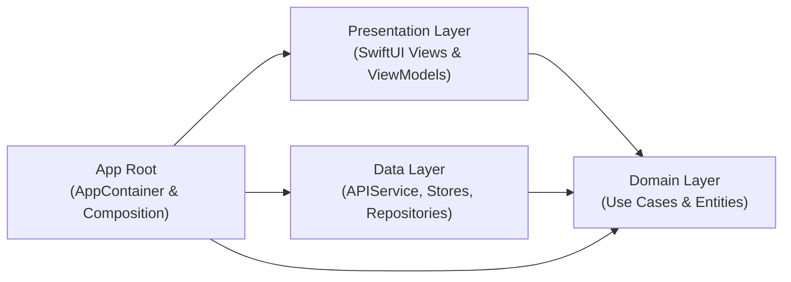

# Motivation Daily 🌟

A modern, fluid iOS application delivering daily inspirational quotes paired with curated, high-resolution aesthetic wallpapers. Built with SwiftUI and Swift Concurrency following Clean Architecture and MVVM principles.

---

## 📱 Features

- **Infinite Motivational Feed**: Vertical swipeable card feed with smooth transitions and real-time pre-warming.
- **Dynamic Session Randomization**: Starts on a randomized quote and wallpaper every time the app opens, preventing repetitive order while maintaining scroll stability within the session.
- **Curated Category Sections**: Switch seamlessly between categories including **Happiness**, **Inspiration**, **Life**, **Success**, **Wisdom**, and **Random**.
- **Non-Destructive Aspect Ratio Customization**: Switch wallpaper display ratios between **Fullscreen**, **1:1**, **16:9**, and **9:16** without degrading or losing the original image canvas.
- **Bookmarks & Favorites**: Save favourite quotes and wallpapers locally for offline browsing and reflection.
- **Rich Share Studio**:
  - Export beautiful composite wallpaper images with embedded typography.
  - Share wallpaper image only.
  - Share quote text only.
  - Copy quote and author directly to clipboard.
  - Save directly to Photos library.
- **Accent Theme Personalization**: Customize UI accent colors across the app.

---

## 🏗 Architecture & Tech Stack

The project adheres to **Clean Architecture + MVVM** with strict layer separation:



### Layer Breakdown
- **App (`MotivationDaily/App/`)**: Dependency injection root (`AppContainer`) wiring use cases, network services, and view models.
- **Domain (`MotivationDaily/Domain/`)**: Pure business logic containing entity models (`Quote`, `FavoriteQuote`), repository protocols, use cases, and domain error definitions. Independent of UI and external SDKs.
- **Data (`MotivationDaily/Data/`)**: Concrete implementations of repositories, network clients (`QuotableClient`, `ZenQuotesClient`, `AdviceSlipClient`), in-memory/disk caching (`FeedCatalogueStore`, `LightImageCache`), and JSON persistence.
- **Presentation (`MotivationDaily/Presentation/`)**: SwiftUI views, view models (`QuoteViewModel`, `FeedPageViewModel`), layout engines (`QuoteCardLayout`), and gesture interaction handlers.

### Technologies
- **UI Framework**: SwiftUI
- **Concurrency**: Swift Concurrency (`async`/`await`, `Task`, `actor`)
- **Minimum Target**: iOS 15.0+
- **Image Pipeline**: Custom `LightImageCache` with async image downsampling and display preparation (`preparingForDisplay()`).

---

## 📂 Project Structure

```text
Motivation Daily/
├── MotivationDaily.xcodeproj
├── MotivationDaily/
│   ├── App/
│   │   ├── MotivationDailyApp.swift
│   │   └── AppContainer.swift
│   ├── Domain/
│   │   ├── Entities/
│   │   ├── Repositories/
│   │   ├── UseCases/
│   │   └── Errors/
│   ├── Data/
│   │   ├── Catalog/
│   │   ├── Network/
│   │   └── Repositories/
│   ├── Presentation/
│   │   ├── ViewModels/
│   │   ├── Views/
│   │   │   ├── Components/
│   │   │   ├── Favourites/
│   │   │   └── HomeView.swift
│   │   └── Shared/
│   └── Assets.xcassets
└── MotivationDailyUITests/
    ├── HomeFlowTests.swift
    └── UITestBase.swift
```

---

## 📋 Known Issues & Tracking

The following items are actively tracked for the Favorites / Bookmarks feature:

### 1. Custom Ratio Favorite Image Retention
- **Description**: Saving a quote when set to a custom aspect ratio (e.g. `1:1`) writes the cropped image data to disk. When reviewing the saved quote in Bookmarks/Favorites, resizing back to Fullscreen or other ratios cannot restore the original uncropped image canvas.
- **Planned Solution**: Persist the uncropped original master image (`content.originalImage`) alongside the chosen aspect ratio metadata, allowing non-destructive re-cropping on demand in the favorites full-screen viewer.

### 2. Sandbox Container Image Persistence Across Reopens
- **Description**: Saved favorite images can become unavailable after the app is reopened multiple times.
- **Root Cause**: `DefaultFavoritesRepository` currently stores absolute file paths (`fileURL.path`) in `UserDefaults`. In iOS, the sandbox container UUID changes between app launches and updates, causing absolute paths to become invalid.
- **Planned Solution**: Store only relative file names in `FavoriteQuote.localImagePath` and reconstruct the full path dynamically at runtime using `FileManager.default.urls(for: .applicationSupportDirectory, in: .userDomainMask)`.

---

## 🚀 Future Plans & Roadmap

### 1. Architecture & Best Engineering Practices
- **Best Engineering Practices Alignment**: Refine the Clean Architecture layer boundaries, enforce protocol abstractions, and align dependency injection with modern Swift paradigms.
- **Strict Concurrency Compliance**: Migrate towards Swift 6 strict concurrency checking (`SWIFT_STRICT_CONCURRENCY=complete`), ensuring Sendable conformance across data transfer objects and actor-isolated stores.
- **Unidirectional Data Flow (UDF)**: Refine state handling so user intents flow through explicit actions and state transitions to prevent unintended view re-renders.
- **Modularization via Custom Swift Packages (SPMs)**: Decouple monolithic targets into standalone packages (`MotivationCore`, `MotivationDomain`, `MotivationData`, `MotivationUI`, `FeatureHome`, `FeatureFavorites`) to speed up compilation and enforce architectural boundaries.

### 2. Testing & Quality Assurance
- **Comprehensive UI Testing**: Broaden automated XCUITest suites to cover all core user journeys, tab switching, sheet presentations, share actions, and error recovery states.
- **Snapshot Testing**: Implement visual regression testing (using Point-Free `swift-snapshot-testing`) across multiple device sizes, light/dark themes, and Dynamic Type accessibility scales.
- **Stub-Data Submodules**: Create dedicated mock and fixture test submodules to provide deterministic JSON payloads and offline fixtures, fully isolating tests from live network dependencies.
- **SwiftLint Integration**: Enforce clean code guidelines, naming conventions, docstrings, and anti-pattern prevention via an SPM Build Tool plugin and pre-commit hooks.
- **Continuous Integration (CI) Pipeline**: Set up automated GitHub Actions to run matrix testing, automated builds, test-result reporting, and code quality verification on every pull request.

### 3. User Experience & Core Enhancements
- **Tab Bar Navigation**: Modernize primary app navigation into a persistent native Tab Bar (Feed, Favorites/Bookmarks, Explore/Categories, Settings) for intuitive discoverability.
- **Cross-Device Sync**: Integrate CloudKit / iCloud sync to seamlessly synchronize favorites, custom themes, and reading history across iPhone, iPad, and macOS.
- **Resilient Image Loading Pipeline**: Enhance the image loader with progressive loading, multi-CDN fallback sources, exponential backoff retries, and disk cache size governance.
- **Accessibility Support**: Ensure full VoiceOver screen reader auditing, custom accessibility actions, high contrast modes, and respectful reduced-motion accommodations for all animated transitions.
- **Performance Measurement & Telemetry**: Instrument MetricKit, `os_signpost` intervals, app launch benchmarks, scroll hitch rate monitoring, and memory footprint tracking.

### 4. iOS System Integrations & Engagement
- **WidgetKit (Home & Lock Screen Widgets)**:
  - Small, Medium, Large, and Extra Large Home Screen widgets showing the Quote of the Day with dynamic wallpaper backgrounds.
  - Circular and rectangular Lock Screen widgets with concise affirmations.
  - Interactive widgets (iOS 17+) with one-tap refresh directly from the Home Screen.
  - StandBy mode interactive display for bedside docks.
- **App Intents, Siri & Shortcuts**:
  - *"Hey Siri, motivate me"* voice command to trigger spoken or on-screen affirmations.
  - Action Button integration (iPhone 15 Pro / 16) for one-press daily quote inspiration.
  - Shortcuts actions (*"Get Daily Quote"*, *"Set Wallpaper"*) allowing users to automate morning routines.
- **Rich Interactive Notifications**:
  - Scheduled morning/evening motivation notifications with rich media previews of the wallpaper and quote typography.
  - Direct notification actions: *"Save to Favorites"* and *"Share Quote"*.

### 5. Multi-Platform Ecosystem
- **Apple Watch Companion App (watchOS)**:
  - Standalone Watch app with cached daily quotes and complications (Modular, Circular, Corner) delivering wrist-based affirmations throughout the day.
- **macOS Companion & Dynamic Wallpaper**:
  - Native macOS menu bar dropdown companion.
  - Automatic desktop wallpaper updates matching the daily motivational image.
- **iPadOS Optimization**:
  - Adaptive two-column split-view / sidebar navigation and full Stage Manager multi-window support.

### 6. Creative Studio & Personalization
- **Typography & Canvas Styling**:
  - Curated font pairings (Modern Serif, Minimalist Sans, Elegant Script, Bold Monospace).
  - Fine-grained controls for quote card opacity, backdrop blur intensity, and text alignment.
- **User Photo Backgrounds**:
  - Allow users to import personal images from their Photos library to pair with any quote.
- **Animated & Parallax Wallpapers**:
  - Gyroscope-based 3D depth parallax motion on quote cards when tilting the device.

### 7. Mindfulness & Habit Building
- **Mood & Intention Tagging**:
  - Quick mood selector (*Grateful*, *Determined*, *Calm*, *Energized*, *Reflective*) dynamically adapting the recommended feed.
- **Daily Reflection Micro-Journal**:
  - Attach a private note or personal reflection to any favorited quote.
- **Reading Streaks & Mindful Milestones**:
  - Gentle, non-intrusive habit tracking celebrating consecutive daily check-ins and reflection milestones.

### 8. Localization & Privacy
- **Localization (i18n) via String Catalogs**:
  - Multi-language quotes and interface translations (Spanish, French, German, Japanese, Hindi, etc.) using `.xcstrings`.
- **Biometric Lock (Face ID / Touch ID)**:
  - Optional biometric protection for personal favorites and private journal entries.
- **Zero-Tracker Privacy Architecture**:
  - 100% on-device processing and analytics, with zero third-party advertising trackers or data harvesting.

### 9. Technical Debt Governance (Engineering & Customer Journey)
Active technical debt backlog and tracking with dual evaluation:
- **Engineering Perspective**:
  - [x] **Eliminate absolute filesystem paths in local persistence**: Migrated `DefaultFavoritesRepository` and `FavoriteQuote` to relative filename storage with dynamic container-aware path resolution (`resolvedLocalImageURL`), fixing broken image links across container UUID updates.
  - [ ] **Decouple singleton dependencies**: Replace direct calls to `LightImageCache.shared` and `ImageLoader.shared` with protocol-injected services in view models and views.
  - [ ] **Isolate live API clients from test targets**: Provide protocol-based mock adapters and offline JSON fixtures.
- **Customer Journey Perspective**:
  - [x] **Preserve original master image on custom ratio saves**: Ensure pristine, uncropped master images are saved on disk so users can freely switch aspect ratios (1:1, 16:9, 9:16, Fullscreen) inside Bookmarks/Favorites without blurriness or cropping artifacts.
  - [x] **Prevent saved favorite images from getting lost on app reopens**: Persisting stable relative image filenames ensures favorites stay intact indefinitely across app launches and sandbox container rotations.
  - [ ] **Eliminate blank card flickers during fast scrolling**: Proactive prewarming and preloading for adjacent cards in the feed.
  - [ ] **Graceful offline recovery banners**: Auto-retry quote and image fetching when network connectivity returns.

---

## 🛠 Getting Started

### Prerequisites
- macOS 14.0 or newer
- Xcode 16.0+ (Tested on Xcode 27.1 Developer Tools)
- iOS 15.0+ Simulator or Physical Device

### Building & Running
Open the project in Xcode:
```bash
open "Motivation Daily/MotivationDaily.xcodeproj"
```

Or build directly from the command line:
```bash
xcrun xcodebuild build \
  -project "Motivation Daily/MotivationDaily.xcodeproj" \
  -scheme MotivationDaily \
  -destination 'platform=iOS Simulator,name=iPhone 16 Pro'
```

### Running Tests
Execute the complete UI and integration test suite:
```bash
xcrun xcodebuild test \
  -project "Motivation Daily/MotivationDaily.xcodeproj" \
  -scheme MotivationDailyUITests \
  -destination 'platform=iOS Simulator,name=iPhone 16 Pro'
```
