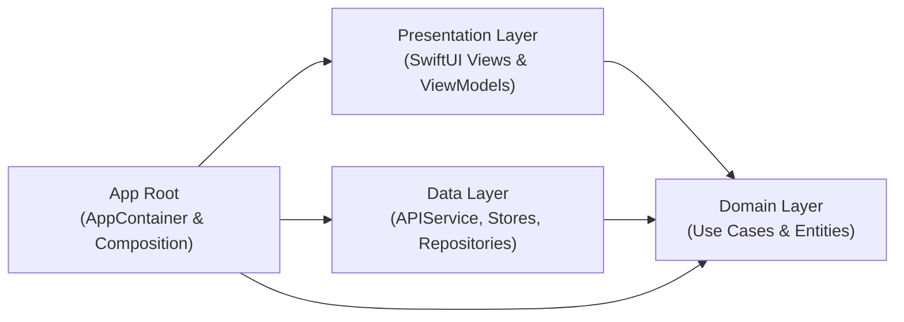

# Motivation Daily 🌟

A modern, fluid iOS application delivering daily inspirational quotes paired with curated, high-resolution aesthetic wallpapers. Built with SwiftUI and Swift Concurrency following Clean Architecture and MVVM principles.

---

## 📱 Features

- **Infinite Motivational Feed**: Vertical swipeable card feed with smooth transitions and real-time pre-warming.
- **Dynamic Session Randomization**: Starts on a randomized quote and wallpaper every time the app opens, preventing repetitive order while maintaining scroll stability within the session.
- **Curated Category Sections**: Switch seamlessly between categories including **Happiness**, **Inspiration**, **Life**, **Success**, **Wisdom**, and **Random**.
- **Non-Destructive Aspect Ratio Customization**: Switch wallpaper display ratios between **Fullscreen**, **1:1**, **16:9**, and **9:16** without degrading or losing the original image canvas.
- **Bookmarks & Favorites**: Save favourite quotes and wallpapers locally for offline browsing and reflection.
- **Rich Share Studio**:
  - Export beautiful composite wallpaper images with embedded typography.
  - Share wallpaper image only.
  - Share quote text only.
  - Copy quote and author directly to clipboard.
  - Save directly to Photos library.
- **Accent Theme Personalization**: Customize UI accent colors across the app.

---

## 🏗 Architecture & Tech Stack

The project adheres to **Clean Architecture + MVVM** with strict layer separation:



### Layer Breakdown
- **App (`MotivationDaily/App/`)**: Dependency injection root (`AppContainer`) wiring use cases, network services, and view models.
- **Domain (`MotivationDaily/Domain/`)**: Pure business logic containing entity models (`Quote`, `FavoriteQuote`), repository protocols, use cases, and domain error definitions. Independent of UI and external SDKs.
- **Data (`MotivationDaily/Data/`)**: Concrete implementations of repositories, network clients (`QuotableClient`, `ZenQuotesClient`, `AdviceSlipClient`), in-memory/disk caching (`FeedCatalogueStore`, `LightImageCache`), and JSON persistence.
- **Presentation (`MotivationDaily/Presentation/`)**: SwiftUI views, view models (`QuoteViewModel`, `FeedPageViewModel`), layout engines (`QuoteCardLayout`), and gesture interaction handlers.

### Technologies
- **UI Framework**: SwiftUI
- **Concurrency**: Swift Concurrency (`async`/`await`, `Task`, `actor`)
- **Minimum Target**: iOS 15.0+
- **Image Pipeline**: Custom `LightImageCache` with async image downsampling and display preparation (`preparingForDisplay()`).

---

## 📂 Project Structure

```text
Motivation Daily/
├── MotivationDaily.xcodeproj
├── MotivationDaily/
│   ├── App/
│   │   ├── MotivationDailyApp.swift
│   │   └── AppContainer.swift
│   ├── Domain/
│   │   ├── Entities/
│   │   ├── Repositories/
│   │   ├── UseCases/
│   │   └── Errors/
│   ├── Data/
│   │   ├── Catalog/
│   │   ├── Network/
│   │   └── Repositories/
│   ├── Presentation/
│   │   ├── ViewModels/
│   │   ├── Views/
│   │   │   ├── Components/
│   │   │   ├── Favourites/
│   │   │   └── HomeView.swift
│   │   └── Shared/
│   └── Assets.xcassets
└── MotivationDailyUITests/
    ├── HomeFlowTests.swift
    └── UITestBase.swift
```

---

## 📋 Known Issues & Tracking

The following items are actively tracked for the Favorites / Bookmarks feature:

### 1. Custom Ratio Favorite Image Retention
- **Description**: Saving a quote when set to a custom aspect ratio (e.g. `1:1`) writes the cropped image data to disk. When reviewing the saved quote in Bookmarks/Favorites, resizing back to Fullscreen or other ratios cannot restore the original uncropped image canvas.
- **Planned Solution**: Persist the uncropped original master image (`content.originalImage`) alongside the chosen aspect ratio metadata, allowing non-destructive re-cropping on demand in the favorites full-screen viewer.

### 2. Sandbox Container Image Persistence Across Reopens
- **Description**: Saved favorite images can become unavailable after the app is reopened multiple times.
- **Root Cause**: `DefaultFavoritesRepository` currently stores absolute file paths (`fileURL.path`) in `UserDefaults`. In iOS, the sandbox container UUID changes between app launches and updates, causing absolute paths to become invalid.
- **Planned Solution**: Store only relative file names in `FavoriteQuote.localImagePath` and reconstruct the full path dynamically at runtime using `FileManager.default.urls(for: .applicationSupportDirectory, in: .userDomainMask)`.

---

## 🚀 Future Plans & Roadmap

### 1. Architecture & Best Engineering Practices
- **Best Engineering Practices Alignment**: Refine the Clean Architecture layer boundaries, enforce protocol abstractions, and align dependency injection with modern Swift paradigms.
- **Strict Concurrency Compliance**: Migrate towards Swift 6 strict concurrency checking (`SWIFT_STRICT_CONCURRENCY=complete`), ensuring Sendable conformance across data transfer objects and actor-isolated stores.
- **Unidirectional Data Flow (UDF)**: Refine state handling so user intents flow through explicit actions and state transitions to prevent unintended view re-renders.
- **Modularization via Custom Swift Packages (SPMs)**: Decouple monolithic targets into standalone packages (`MotivationCore`, `MotivationDomain`, `MotivationData`, `MotivationUI`, `FeatureHome`, `FeatureFavorites`) to speed up compilation and enforce architectural boundaries.

### 2. Testing & Quality Assurance
- **Comprehensive UI Testing**: Broaden automated XCUITest suites to cover all core user journeys, tab switching, sheet presentations, share actions, and error recovery states.
- **Snapshot Testing**: Implement visual regression testing (using Point-Free `swift-snapshot-testing`) across multiple device sizes, light/dark themes, and Dynamic Type accessibility scales.
- **Stub-Data Submodules**: Create dedicated mock and fixture test submodules to provide deterministic JSON payloads and offline fixtures, fully isolating tests from live network dependencies.
- **SwiftLint Integration**: Enforce clean code guidelines, naming conventions, docstrings, and anti-pattern prevention via an SPM Build Tool plugin and pre-commit hooks.
- **Continuous Integration (CI) Pipeline**: Set up automated GitHub Actions to run matrix testing, automated builds, test-result reporting, and code quality verification on every pull request.

### 3. User Experience & Feature Enhancements
- **Tab Bar Navigation**: Modernize primary app navigation into a persistent native Tab Bar (Feed, Favorites/Bookmarks, Explore/Categories, Settings) for intuitive discoverability.
- **Cross-Device Sync**: Integrate CloudKit / iCloud sync to seamlessly synchronize favorites, custom themes, and reading history across iPhone, iPad, and macOS.
- **Resilient Image Loading Pipeline**: Enhance the image loader with progressive loading, multi-CDN fallback sources, exponential backoff retries, and disk cache size governance.
- **Accessibility Support**: Ensure full VoiceOver screen reader auditing, custom accessibility actions, high contrast modes, and respectful reduced-motion accommodations for all animated transitions.
- **Performance Measurement & Telemetry**: Instrument MetricKit, `os_signpost` intervals, app launch benchmarks, scroll hitch rate monitoring, and memory footprint tracking.

### 4. Technical Debt Governance (Engineering & Customer Journey)
Establish an active technical debt backlog with dual evaluation:
- **Engineering Perspective**:
  - Eliminate absolute filesystem paths in local persistence (`DefaultFavoritesRepository`) by migrating to relative path resolution.
  - Decouple singleton dependencies (`LightImageCache.shared`, `ImageLoader.shared`) in favor of protocol-injected services.
  - Isolate live API clients from test targets through protocol mocks.
- **Customer Journey Perspective**:
  - Fix favorite resizing so master uncropped images are preserved when saved from custom ratios (e.g. 1:1).
  - Prevent saved favorites images from being lost across app reopens by eliminating stale sandbox container paths.
  - Eliminate blank card flickers during fast scrolling via proactive prewarming.
  - Provide graceful offline recovery banners with automatic retry when connectivity returns.

---

## 🛠 Getting Started

### Prerequisites
- macOS 14.0 or newer
- Xcode 16.0+ (Tested on Xcode 27.1 Developer Tools)
- iOS 15.0+ Simulator or Physical Device

### Building & Running
Open the project in Xcode:
```bash
open "Motivation Daily/MotivationDaily.xcodeproj"
```

Or build directly from the command line:
```bash
xcrun xcodebuild build \
  -project "Motivation Daily/MotivationDaily.xcodeproj" \
  -scheme MotivationDaily \
  -destination 'platform=iOS Simulator,name=iPhone 16 Pro'
```

### Running Tests
Execute the complete UI and integration test suite:
```bash
xcrun xcodebuild test \
  -project "Motivation Daily/MotivationDaily.xcodeproj" \
  -scheme MotivationDailyUITests \
  -destination 'platform=iOS Simulator,name=iPhone 16 Pro'
```
